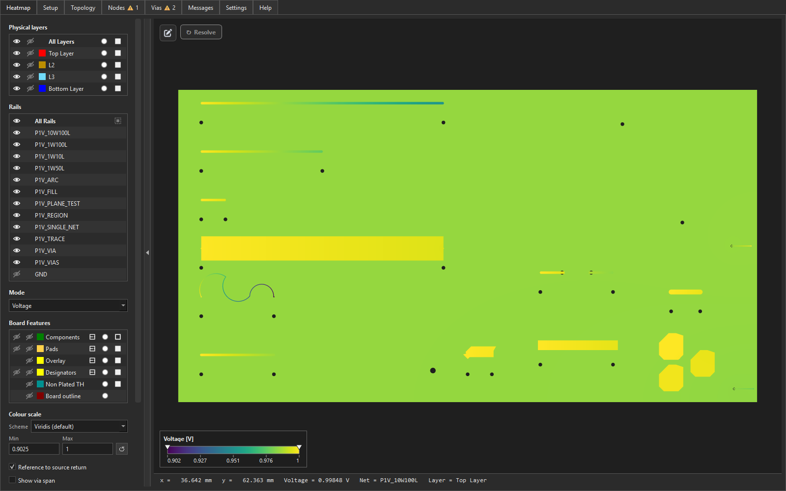

# 5. The viewer tour

Once FYPA has solved your PDN, the viewer is where you spend the rest
of your time. This section walks through the layout, the tabs on the
side panel, the display modes, and the interactions worth knowing.

> The first four sections all assume you have a solved project open in
> the viewer. If you have not got that far yet, start with
> [Section 1.6](01-sources-and-sinks.md#16-importing-into-fypa).

## 5.1 Layout overview

A row of tabs runs across the top, laid out left to right in the order
you work:

- **VIEWS** - Board and Topology: the two canvases, the physical layout
  and the electrical diagram of the same design. You set up sources,
  sinks and regulators on them, and they show results once you have
  solved, so their bracket shades from the setup colour into the results
  colour. Until there are results, and while they are out of date, the
  two tabs carry the same marks as the results tabs.
- **SETUP** - Properties and Bridges: what goes into the solve.
- **RESULTS** - Nodes, Vias, Fixes, Capacitors and Impedance: what comes
  out of it. The caption is green while the results are current, and
  reads *OUT OF DATE* once the setup has changed since the last solve,
  or *NOT SOLVED YET* before the first one. **Capacitors** and **Fixes**
  run their analysis only when you open them; until they have run for the
  loaded design they carry a small pending icon (a ring with three dots)
  after their name, because until then they can't show a warning count. A results tab is greyed while it has nothing to show, and
  in italics while its numbers are from before a setup change.
- **APP** - Messages, Settings and Help: about the program rather than
  one stage of working on the design, in a quieter grey. Settings holds
  application preferences only; they never change a solve result.

The **Board** tab, where you spend most of your time, is itself split
into three areas:

- **Control panel (left)** - the Board tab's controls, top to bottom:
  the **Physical layers** list, the **Rails** list, the **Mode**
  dropdown, the **Board Features** toggles, and the **Colour scale**
  (scheme picker and Min / Max boxes). On a board with more than one
  via type, the **Vias** row unfolds into Through / Blind / Buried /
  Micro sub-rows, each with its own eyes and colour.
- **Viewport (centre / right)** - the OpenGL canvas. Shows the current
  layer's copper, shaded by the current display mode. Pan with the
  mouse, zoom with the wheel.
- **Status bar (bottom)** - hover-probe readouts (the x / y / value /
  net / layer under the cursor) and short hints.

A small **colour-scale strip** is pinned to the bottom-left of the
viewport, with two draggable handles for clamping the display range.

The remaining tabs hold the node / via tables, the topology diagram,
solver messages, and settings - each is covered in its own section
below.



### Global Focus - one rail on every tab

On the menu bar, above the Nodes tab, is a gold eye reading
**GLOBAL FOCUS Off**. Click it and pick a rail (or right-click a rail
in the Board tab's **Rails** list and choose **Global Focus on ...**),
and every tab shows only that rail until you leave:

- **Board** - only that rail's copper, vias, pads and markers are drawn,
  and the Rails list shows only that rail.
- **Nodes, Vias, Bridges, Fixes, Capacitors, Impedance** - only that
  rail's rows. Their own **Rail** pickers are hidden, and the warning
  counts on the tab names are for that rail.
- **Topology and Properties** - only the sources, sinks, regulators and
  series parts on that rail.
- **What-If** comparison - only that rail's nodes; the headline numbers
  are worked out from those (copper loss and temperature rise are whole-
  board figures, so they are left out).
- **Editor mode** - only that rail's copper can be clicked, and the P
  and IN net pickers list only its nets. The N net picker is unchanged.
  A new regulator can't be added while focused, because it joins a
  second rail - leave focus first, as you would to set up a new rail.

The rail's return net (GND) and any rail upstream of a regulator are
not part of the focus, so a sink's ground pins and a regulator's far
end are hidden. A thin gold line under the menu bar shows that focus is
on. Click the rail name to switch to another rail, or the **x** next to
it to show every rail again - your rail eyes come back as they were.

Focus is a view filter: it never changes or re-runs a solve. It is not
saved, so a window always opens with it off, and it goes off by itself
when another design is opened or the focused rail no longer exists
after a solve. The **Messages** and **Settings** tabs, and the design
report, are not filtered.

### Design issues - the strip along the bottom

When a design loads, or a solve finishes, some things may need your
attention: a directive that was skipped, a rail left out of the solve, a
source and sink on copper that is not connected, copper that could not be
meshed. These are listed in the **Design issues** panel, a strip along
the bottom of the window that stays there whichever tab is open:

```
> Design issues   (x) 1 Error   (!) 2 Warnings   (i) 14 Notes
```

- The strip is shown only while the design has an error or a warning. A
  clean design gives the board its full height.
- It starts closed. Click the strip to open the list, and again to close
  it; drag its top edge to resize it.
- The three counts are also filters. **Errors** and **Warnings** start
  on. **Notes** are what FYPA worked out by itself (a local net it
  matched, a 0 Ω link it bridged) and start off.
- Each row says what kind of issue it is, the part or rail it is about,
  and the full message.
- **Double-click** a row to go to that part or rail: on the Topology
  diagram when that tab is open, otherwise on the Board. A mesh failure
  goes to its marker; an unapplied saved setup opens the review.
- **Right-click** for *Copy* (`Ctrl+C`, the description) or *Copy Row*
  (tab-separated, for pasting into a spreadsheet or a bug report).

| Shown as | Means |
|---|---|
| **Error** | Part of the design was left out of the solve, or a result can't be trusted: a skipped directive, disconnected copper, a failed mesh. |
| **Warning** | Worth checking, the solve is otherwise sound: a rail with a source but no sink, an unknown `PDN_*` parameter, a saved setup entry that could not be applied, an unannotated bridge. |
| **Note** | For information only. |

After a load, one pop-up says how many errors and warnings there are and
points at the panel; **Show Issues** opens the list. It comes back after
a solve only when the solve turned up something new, not every time.

Parts that join a solved rail to copper outside the solve (a ferrite to
an unannotated net, say) count as warnings. If on your boards those parts
really are open at DC, untick **Count unannotated net bridges as design
warnings** in *Settings > General options* and they are listed as notes
instead. The Bridges tab lists them either way.

The panel is for problems with how the design is set up. A result that
misses a limit - a load below its minimum voltage, a via over its current
limit - is counted on its own tab and in the design report, and the
**Messages** tab remains the program's log.

## 5.2 The Properties tab

The Properties tab holds everything that defines **this design's solve**.

- **Left - Base properties** (editable): what the real board is, set to
  match your fabrication and operating conditions. *Physics* (board
  temperature, copper resistivity and temperature coefficient, via
  plating per via type, multi-pin coupling, the coupled electro-thermal
  model, adaptive SMPS gain), *Conductive via fill* and *Stackup*
  (per-layer copper thickness and resistivity). A collapsed *Advanced*
  section holds *Mesh* (accuracy and speed, not physics) and the
  *Capacitor loop inductance* knobs. A changed field is outlined;
  **Re-run Solver** (or **Solve**) replaces the base result with one
  solved from the new values. To try an alternative *without* changing
  the base, make a What-If instead ([Section 9](09-what-if-scenarios.md)).
- **Right - design report** (read-only): what the solver was actually
  given - extracted record counts, the copper stackup, physics
  constants, the parsed `PDN_*` directives (click one to expand it),
  active nets, mesh and solver statistics, bridged nets and the
  annotation warnings / errors.

The controls for what the viewport shows live in the Board tab's
left-hand side panel (5.9). From top to bottom:

- **Layer picker** - every copper layer in the stackup. Click to
  switch which layer the viewport renders.
- **Rail picker** - every rail FYPA inferred from your `PDN_P_NET` /
  `PDN_N_NET` pairs. Click to switch which rail's voltage / current is
  shown.
- **Mode dropdown** - *Voltage*, *Voltage Drop*, *Current Density* or
  *Power Density* (see 5.4).
- **Colour-scheme picker** - the matplotlib colormap used to shade the
  mesh (default `viridis`).
- **Min / Max boxes** - type a value to clamp the colour scale, or
  drag the handles on the scale strip in the viewport.
- **Per-layer transparency buttons** - fade individual layers to see
  underlying copper.

> Use the **R** hotkey to toggle "rail-only" mode - hides everything
> except the selected rail's copper. Useful on a busy board where
> you want to see one rail without the visual noise of all the
> others.

## 5.3 The Topology tab

The **Topology** tab shows the **power tree** of the PDN
simulation model - each `PDN_*` directive appears as a coloured box with
labelled input/output ports; wires connect ports that share the same net.
This is **not** the PCB layout; for spatial placement use the Board tab.

The icon-only squares at the diagram's top-left are **Auto setup**,
**Manual setup** and **What-If**; rest the mouse on one
for a moment and it widens to show its name. **Solve** is at the
right-hand end of the tab row, as on every tab.

- **Rows** - each SOURCE starts a row, and each REGULATOR gets its own
  row directly under the row that feeds it, indented one step per
  conversion stage, so reading top to bottom follows the power tree. Each
  row sits on its own panel, under a header line that names the row and
  summarises it (`+12V → BUCK · 1 V → +VDD`); click the header to collapse
  the row.
  Within a row power flows left to right: a net's driver on the left, the
  parts it feeds stacked in the next column.
- **Tags** - a rail that leaves the row is not drawn as a long wire. It
  ends in a pentagon **tag** instead: `U6` (purple) where a rail feeds a
  regulator, the input net (red) on the regulator's own row, the net name
  where a rail loops back to a part drawn elsewhere. **Click a tag** to
  jump to the other end; hovering one highlights the whole net. A dashed
  amber tag marks a rail nothing drives (such rails get their own amber
  row, headed by the rail name and *no source feeds this rail*); a grey tag marks a rail with no sink or regulator.
- **Ground** - every part with a return gets its own ground symbol under
  it; there is no shared return rail.
- **Issue icons** - a block with a
  [design issue](#design-issues---the-strip-along-the-bottom) is outlined
  and carries a small triangle: red for an error, amber for a warning.
  Rest the mouse on the block to read the message. An issue about a whole
  rail is shown on the sources, sinks and regulators on that rail.
- **SERIES chips** - a two-pin SERIES part (fuse, shunt, ferrite,
  inductor DCR) is drawn as a one-line **green** chip:
  designator, resistance, input rail on the left, output rail on the
  right. Its two nets stay separate and it has its own drop in the solve.
  SERIES parts with more channels, or with a return, keep the full card.
- **Bridges** - 0 Ω auto-bridges on a powered rail show as the same
  one-line chip, tinted **grey**. FYPA merges the two nets a link joins into one, but the
  chip still shows the far side: `VOUT_2V5 → R106 → +ETH_2V5`, with the
  parts on `+ETH_2V5` (and its `+ SINK` handle) hanging off the chip
  rather than the regulator. This needs the design in memory, or a
  project opened before with it. Auto-bridges on nets no source, sink or regulator uses
  (pull-up links, signal jumpers) are hidden; toggle **Bridges** under
  **View options** to list them, grouped by net.
- **Add handles** - a dashed blue `+ SINK (n)` tap under each rail's last
  load, where *n* more parts on the rail (ICs, connectors) aren't set up on
  it yet. A rail with nothing on it yet - typically the far side of a
  SERIES part on a regulator's output - ends in the handle itself instead
  of a grey "no loads" tag. See *Adding sources, regulators and sinks* below. Toggle it off
  under **View options** for a tighter diagram. The parts per rail are saved in
  the project's cache folder whenever the design is loaded, so a project
  reopened from its cache shows the same handles. A Gerber import shows
  none.
- **Cascade** (under **View options**) - draws each regulator inline,
  wired straight off the rail that feeds it, instead of on a row of its
  own: `J2 → R18 → U6 → J1` reads as one row. Regulators fed by the same
  rail stack in that rail's column, and each one's loads carry on to its
  right. A regulator with a second input rail (another channel) sits on
  the first rail to reach it; the other input keeps its tag, matched by a
  `U6` tag where that rail is drawn. The View options toggles are
  remembered between sessions.
- **Voltage gauges** (under **View options**, on by default) - each SINK
  with a `PDN_MIN_V`, and each regulator input with a dropout or
  `PDN_VIN_MIN`, gets a gauge under its ports (the block is drawn wider
  to fit it). A load with only a maximum gets none. The slim track reads
  left (lower voltage) to right:
  - **zones** - green where the voltage is allowed (minimum to maximum,
    or to the end when there is no maximum), faded red outside it. Green
    ticks mark the limits, labelled `min` / `max` underneath. Every gauge
    is scaled to its own window, so healthy gauges look alike and an
    outlier stands out.
  - **caret above the track** - the supply before any drop, labelled
    `supply`: a small caret at its setpoint, or a bracket over its range
    (`PDN_V_TOL` / `PDN_V_MIN` / `PDN_V_MAX`). A label that would overlap
    another is left out; hover for every number.
  - **dot on the track** - where the voltage at the load's pins sits.
    When the supply has a range it becomes a capsule, from the supply at
    its minimum to the supply at its maximum with the rail lightly loaded.
    The gap between the caret and the dot is the drop in the copper.
    Inside the window the dot is the text colour (pass) or amber (margin
    under the report's warning share); only the part past a limit is red.
    A value off the scale pins to that end with an arrow.
  - **line above the track** - the worst margin with the limit it is to:
    `✓ +74.5 mV to min`, `⚠` for a low margin, `✗` for a fail (a negative
    margin is past the limit by that much). With **Port voltages** off it
    is led by the voltage at the pins: `0.975 V · ✓ +74.5 mV to min`.

  **Gauges as text** (under **View options**) swaps the track for two lines:
  the margin (`✓ +74.5 mV to min`, with the voltage at the pins in front
  when **Port voltages** is off), then the limits and supply, e.g.
  `min 0.9 V · max 1.04 V · supply 0.97–1.05 V`. It is shorter, and easier
  to read when zoomed out.

  The voltage is **supply pins minus return pins**, the same "voltage at
  load" as the design report, so ground rise counts against the margin.
  Hover a gauge for the numbers: the range at the pins, the limits, the
  margin, and the drop with its return-path share. Readings come from the
  last solve; with edits pending, the gauges are faded until you
  **Solve**. Before the first solve a gauge shows its limits and *not
  solved yet*.
- **Port voltages** (under **View options**, on by default) - the solved
  voltage on the wire beside each SOURCE, REGULATOR and SINK supply port:
  right of an output, left of an input, e.g. `1.000 V` at a regulator's
  output and `0.991 V` at the sink it feeds, each on a small pill. Tags on
  the same side of the block sit further out so a pill never covers one.
  It is the port's pins minus
  their return pins (a load's lowest pin, an output's average), so the
  two ends of a wire differ by that rail's drop, ground rise included.
  Hover the port for the same figure. Faded, like the gauges, while edits
  are pending.
- **Nodes** - one box per directive (SOURCE, SINK, REGULATOR, SERIES);
  the header is tinted in the role colour and shows the role name and
  designator, and the outline and ports take the same colour; the body
  shows the configured value (`PDN_V`, `PDN_I`, `PDN_R`, regulator gain).
  A free marker dropped on the copper has a **dashed** outline and shows
  its name (`SRC1`, or one you typed) where a part shows its designator.
- **Ports** - small connectors on the left (inputs) and right (outputs).
  Each port is labelled with the **physical PCB net name** from the pad
  assignment (the same names you see on the Board and in the Nodes
  table), not the schematic `PDN_*_NET` text or the merged rail name from
  the Rails list. Ground ports are the exception: they keep the schematic
  name you gave them (`GND`, `AGND`, …). When one directive terminal ties
  several pads on different nets (multi-pin part), the port label lists
  every distinct net, comma-separated; hover the port for the full list if
  the label is truncated. Multi-channel parts show one net per channel row
  (`N1`, `N2`, …) - the net that row's wire actually carries.
- **Wires** - orthogonal links between ports on the same electrical net,
  each labelled once above the link. Single-net directives (ideal return)
  show only their power port and are drawn in a darker shade.
- **Annotation errors** - errored directives get a red border and ⚠ marker.
- **Click a box** - opens that part's PDN properties in a sidebar on the
  right: the same form as the Board's PDN editor panel. A part set up in
  the schematic shows its values read-only with **🔓 Unlock to edit**; a
  part with several FYPA directives (one per rail) gets a picker above the
  form. **Apply** updates the diagram straight away; **Solve** on the
  tab row re-solves.
- **What-If** (under **Manual setup…**; or **W**) -
  shows the What-If panel on the right of this tab, the same panel as on
  the Board. It shares that side with the part sidebar: whichever you
  opened last is shown. Open / closed is remembered separately for the
  Board and Topology tabs. Opening it leaves editor mode, and clicking a
  box switches the view back to the base design, since the form edits it.
- **⌖ icon** (bottom-right of each box) or **Show on Board** in the
  sidebar - jumps to that component's pad on the Board (same as **Go ▶**
  on the Nodes tab).
- **Hover a box or port** - tooltip with the configured value.

### Adding sources, regulators and sinks from the diagram

Click a **dashed amber tag** (a rail nothing drives) to add a SOURCE on
it or a REGULATOR whose output it is; click a **grey tag** (a rail with
no sinks) to add a SINK. To add **another** sink to a rail that already
has one, click its dashed blue **`+ SINK (n)`** handle under the last
sink. Each opens **Manual setup** (below) on a new entry for that net,
with the part auto setup would pick, when it is confident, and its values
filled in. A new sink is never preset to a part already on that rail. On
the **Sinks** tab the **Part** list shows only the parts the handle
counted: ICs and connectors on the net not already set up on it. Tick
**Show all parts** to pick any part with a pin on the net, such as a
resistor; there, a part already a sink on the net is listed last, marked
*already a sink here*. Check the value (`3.3 V`, `250 mA` - SI prefixes
are fine) and **Apply**.

### Manual setup

**Manual setup…** on the toolbar opens the whole supply side of the PDN
as two lists, **Sources & regulators** and **Sinks**, each with **Add**,
**Duplicate** and **Remove** and an editor for the selected row:

- **Sources & regulators** have a **Type**: *Source* (an ideal supply such as a
  connector), *LDO* (input current = output current) or *Switcher* (input
  power = output power ÷ efficiency). A regulator also needs its **Input
  net**, and a switcher takes an efficiency and an optional topology.
  **Sense at** sets remote sense: *at its own pins* (local sense) or a
  part on the output net, usually the load, with an optional pin list.
  **Sense return at** does the same on the ground net. The supply then
  holds its voltage there and its own pins rise by the copper's drop
  (see [Remote sense](01-sources-and-sinks.md#remote-sense-pdn_sense_des)).
  Changing the output or ground net drops a sense point that is no
  longer on it.
- **Sinks** take a current and an optional minimum voltage; the Nodes tab
  flags the sink if its pins sag below that.
- Every row is picked the same way: the **net** (type to search; rails
  come first), then the **part** on it (busiest first, e.g.
  `U7  MAX38913AATD+  (3)`), then optionally its **pins** (blank = all
  of that part's pins on the net). **Ground** is the return net, or
  *(ideal return)* for a source or sink that returns through an ideal 0 V
  node. A sink with an ideal return needs a source with an ideal return
  on its rail to take its current back; on a rail supplied through GND
  copper it must have that ground net instead.
- Empty fields fill in from the design, and nothing you typed is
  overwritten: the voltage from the net name (`+1V8` → 1.8 V), the
  ground from the part's ground pins, and a regulator's input when the
  part has exactly one other rail.
- **Split across nets…** (Sinks) shares one part's total current over
  all its supply rails by how many supply pins each has, e.g. a level
  shifter on both its VCC(A) and VCC(B) rails.
- Directives defined in the Altium schematic are listed locked (🔒).
  **Override** turns one into an editable FYPA copy that replaces it on
  the next solve; removing the copy brings the schematic one back.
- Problems are listed under the tabs. Errors, such as a missing value,
  pins that aren't on the chosen net, a sense part or sense pin that
  isn't on the supply's net, input = output, or an ideal-return
  sink on a rail supplied through copper, must be fixed
  before **Apply**. Warnings, such as a sink on a rail nothing supplies
  yet, don't block it.

- Free source / sink markers dropped on the Board are listed too (◎,
  with their location). Their value, output range, voltage limits and
  ground can be edited here, and **Remove** deletes one. Their net and
  place are the copper they sit on, so they are changed on the Board:
  **Apply and show on Board** applies your edits and zooms the Board to
  the marker (selected, if editor mode is on). **Duplicate** is off for
  them; drop another marker on the Board instead.

Nothing changes until **Apply**. Series elements (sense resistors,
ferrites, 0 Ω links) are set up on the **Bridges** tab.

### Auto setup

**Auto setup…** on the toolbar proposes a whole PDN setup and lets you
review it before anything changes:

1. **Datasheet folder** (optional). PDFs are matched to parts by part
   number, from the file name or else the first page, so
   `INA238AQDGSRQ1` finds `ina238.pdf`. From a datasheet it reads whether
   a part is a regulator, LDO or switcher, its topology, efficiency,
   supply / quiescent current and DC resistance or on-resistance. Without
   a folder it works from the design alone, and those values become
   estimates.
2. **Analyse.** The design is read for pin names (`VIN`, `VOUT`, `SW`,
   `VCC(A)`…), net names (`+1V8` means 1.8 V), part parameters and the
   power-port symbols on the schematic:
   - **Regulators**: parts with input and output pins on different rails,
     or a switch pin whose inductor leads to the output. A part with the
     same voltage in and out and no switch pin is a load switch: SERIES.
   - **Sources**: a connector on a rail nothing on the board drives.
   - **Sinks**: ICs with supply pins (VCC, VDD, VS…) on a rail, one per
     part and rail.
   - **Series**: resistors under 1 Ω and ferrite beads between two rails.
   Parts already set up in the schematic or the editor are left alone.
3. **Review.** Each suggestion has a tick box, its nets, an editable value
   (double-click), and for regulators the type and efficiency.
   **Amber** values are estimates. Rows missing a value (a regulator
   whose output rail name carries no voltage, say) can't be ticked until
   you fill it in. Select a row to see why it was suggested, including the
   datasheet sentence a value came from. **Apply** adds the ticked
   suggestions as ordinary FYPA editor directives; edit or remove them
   like any other.

Auto setup only reads the design and proposes values; nothing is solved
until you press **Solve**. Datasheet values are typical figures pulled
from the text, so treat every suggestion as a starting point to check.

### Navigation and zoom

The diagram is rendered as a **vector schematic** (SVG) and can be
panned and zoomed independently of the Board viewport:

| Action | How |
|--------|-----|
| **Scroll vertically** | Mouse wheel (no modifier). |
| **Scroll horizontally** | **Shift** + mouse wheel. |
| **Zoom** | **Ctrl** + mouse wheel (around the cursor), or the **+** / **−** toolbar buttons. |
| **Fit diagram** | **Fit** toolbar button, or **Ctrl+0** while the Topology tab is focused. A tall power tree fits its width and starts at the top; scroll for the rest. |
| **Pan** | Middle-button drag, or hold **Space** and drag with the left button. |
| **Pan (keyboard)** | Arrow keys; hold **Shift** or **Ctrl** for larger steps. |

Keyboard zoom shortcuts (**Ctrl++**, **Ctrl+=**, **Ctrl+-**) work while
the Topology tab (or one of its controls) has focus.

> **Note:** Board-tab gestures differ - there the mouse wheel zooms the
> board view directly (see [Section 5.10](#510-interaction-reference)).
> On the Topology tab, plain wheel scrolls and **Ctrl**+wheel zooms,
> matching browser and document-viewer conventions.

## 5.4 The display modes

Switching the mode dropdown (or pressing **M** to cycle, **Shift+M**
to cycle back) changes what each mesh vertex's colour represents:

| Mode               | Units    | What it shows                                                                                  |
|--------------------|----------|------------------------------------------------------------------------------------------------|
| **Voltage**        | V        | Absolute potential at every node. The hottest colour is the supply, the coldest is the return. |
| **Voltage Drop**   | V        | Signed drop relative to the rail's source. Useful for "how much voltage have I lost between J1 and U5?" Each rail is measured from its own source, so several rails shown together share one scale whatever their voltages. |
| **Current Density**| A / mm²  | Magnitude of the current density `|J|` per mm² of copper cross-section at every node, so layers of different copper weight compare directly. Highlights bottlenecks. Via barrels show their current over the plated wall's cross-section; series resistors are drawn grey. |
| **Power Density**  | W / mm²  | Resistive power dissipation per unit area. Highlights hot spots - where copper will warm up. |
| **Via Current**    | A        | Current through each via; the copper is drawn grey as context. |

> Current Density and Power Density tend to spike sharply at narrow
> tracks and pad corners. The colour scale auto-clips the top end on
> these modes so a single 10× spike does not flatten the rest of the
> board into one colour. Use the Min / Max boxes to override.

## 5.5 The Nodes tab

One row per terminal pin (every pad on every SOURCE / SINK /
REGULATOR / SERIES directive). Columns:

- **Designator / Pad** - which part, which pad.
- **Net** - the net this pin connects to.
- **V** - the solved voltage at this pin.
- **Min V**, **Max V**, **Margin**, **Status** - populated for SINK
  pins that carry a `PDN_MIN_V` or `PDN_MAX_V` value
  (see [Section 1.3](01-sources-and-sinks.md#optional-pdn_min_v--minimum-acceptable-voltage-at-the-sink)),
  and for a REGULATOR's input pins when it has a dropout or input
  limits (see [Section 4](04-regulators.md#input-headroom-pdn_dropout-pdn_vin_min-pdn_vin_max)).
- **V low**, **V high** - the pin's worst case when the supply feeding
  its rail has a tolerance: the solved voltage with the supply at its
  minimum, and the lightly loaded rail with the supply at its maximum.
  Blank when the supply has no tolerance (V high still shows where there
  is a Max V to compare with).
  *Margin* is the smallest margin to a limit, at nominal and in the
  worst case; rows with a negative margin are highlighted red with
  `Status = FAIL`. Hover a column header for its definition.

The table is sortable - click a column header to sort by it. Sorting
by Margin ascending is the fastest way to find which pin is closest
to falling below its limit.

Right-click a SINK row and choose *Show fixes for …* to open the
**Fixes** tab on that sink.

### The Fixes tab - where would copper help?

The heatmap shows where current flows. The **Fixes** tab answers the
question you ask next: *for this sink, where would extra copper cut its
drop the most?* Copper carrying another sink's current, or copper beyond
the sink, scores nothing.

The report doesn't run when you open the tab - click **Run fixes
report**. It stays up until the solution changes (a re-solve or a
what-if), then the button comes back. *Show fixes for …* on the Nodes
tab runs it straight away.

- **Sinks** (left) - every SINK, worst first, by how much of its drop
  budget it uses. The budget is `nominal − PDN_MIN_V` when the sink has
  a `PDN_MIN_V`, otherwise 5 % of the rail's nominal voltage. When the
  rail's source has a tolerance the budget is counted from the source's
  minimum instead of the nominal, so it matches the worst case. Over-budget
  sinks are red. The drop is the same number the design report shows.
- **Fixes** (right) - for the selected sink, ranked by the voltage each
  would gain:
  - **Widen** - push this copper edge out by 0.25 mm. For a trace,
    either edge.
  - **Add layer** - a stitched parallel copy of the copper, same weight,
    on another layer. The layers with room for it are named.
  - **Add via** - another via beside this one.

  Fixes that would run into another net's copper are greyed and listed
  last. Click **Go** to jump to a fix on the heatmap.

**Try as what-if** (or right-click a fix) turns the selected **Add via**
fixes into a What-If and runs it, so the real change sits next to the
estimate. Each gets a copy of its via (drill, pad, layers and fill) at the
nearest free spot beside it, found with the same rules as punching a via by
hand (see 9.3). Ctrl- or Shift-click several to try them together in one
What-If. The What-If's notes keep the tab's estimate, and its comparison
shows what the solve made of it. A fix with no free spot nearby is
reported and left out. Widen and Add layer fixes change copper shapes,
which a What-If can't. While the What-If panel shows a What-If's own
result, the Fixes tab ranks fixes for that result, so **Try as what-if**
is off there: show **Base** and run the report again first.

**Show fixes on the heatmap** draws every fix of the selected sink over
whatever mode the heatmap is in - a line along an edge to widen, a dashed
outline round copper to parallel, a ring on a via - numbered as in the
table. **Show value map** colours the heatmap by where parallel copper
would help the sink most (volts gained per mm²) instead of the Mode
quantity; choosing a mode turns it off.

The ranking comes from one extra ("adjoint") solve per load, done with
the main solve, so it adds little to solve time. The estimates are
**first order**: they hold well for modest changes (a widen estimate on
a test trace was within 1 % of re-solving with the trace widened; a
parallel-layer estimate within 10 %) and are optimistic for large ones.
Re-solve to confirm a fix.

## 5.6 The Vias tab

One row per via on the board, with the current flowing through it.
Columns:

- **Net** - which net the via belongs to.
- **From / To** - the two layers it connects.
- **Type** - Through, Blind, Buried or Micro (a blind or buried via
  across one dielectric with a drill of 0.15 mm or less).
- **Current (A)** - the solved current through the via.

Sort by Current descending to spot vias that are carrying too much -
a 0.3 mm hole carrying 2 A is a future failure. The
[via resistance model](../via_resistance_model.md) covers how those
currents are computed.

## 5.7 The Messages tab

Warnings and diagnostics from the loader and solver - anything that
did not abort the run but is worth knowing about. Examples:

- Net names referenced in `PDN_*` parameters that were not found on
  the PCB (and were therefore skipped).
- Editor directives that could not be applied (skipped, not aborted -
  see [Section 2.10](02-sources-and-sinks-editor.md#210-troubleshooting)).
- Solver warnings about near-singular matrices, suspicious gradients,
  etc.

Worth a glance after every solve. If everything is healthy, the tab
shows a short "no issues" message.

This is the program's log, so design problems sit among everything else
it wrote. The ones you need to act on are picked out in the
[Design issues panel](#design-issues---the-strip-along-the-bottom) at the
bottom of the window.

## 5.8 The Settings and Help tabs

- **Settings** - application preferences only, which never change a
  solve result: *Appearance* (theme, high-quality zoom), *Display
  options* (via current warning level, colour-scale clip percentile,
  *Markers always on top* - on by default, so markers (source, sink,
  series part, via, PTH) paint over every layer; turned off, the part of
  a marker that copper drawn above its layer covers is hidden, in 2D and
  3D - rail and other copper alike - and copper given some transparency
  shows the marker through it at that transparency. The same setting is
  in the **View** menu as *Markers always on top [enabled / disabled]*;
  the View menu's *Board origin (0, 0) [shown / hidden]* marks the
  design's origin - the point every coordinate is measured from - with a
  circle and cross, off by default and remembered),
  *General options*, *Performance* and *Experimental*. They persist
  across launches. The design's base properties are on the Properties tab.
- **Help** - built-in cheatsheet of hotkeys and gestures.

## 5.9 The Board tab

The viewport itself lives in a tab called *Board*; after a solve the
heatmap is drawn over the board there. You will rarely
click away from it during normal use - the other tabs hold the setup
controls, node / via tables, messages, and settings.

Markers on the pins say what each part does to its rail: a red ▲ is a
SOURCE, a blue ▼ a SINK, a green ■ a SERIES part. A regulator is
magenta at both ends - ▲ on its output pins, where it supplies the rail,
and ▼ on its input pins, where it loads the rail feeding it. A ground
pin that serves as the return for both ends belongs to neither, and is
a magenta ◆. The legend at the top right lists them as **REG OUT**,
**REG IN** and **REG RETURN**; like every legend row, each one hides or
shows its markers when clicked.

## 5.10 Interaction reference

| Action                          | How                                                                  |
|---------------------------------|----------------------------------------------------------------------|
| Pan                             | Left-click and drag in the viewport.                                 |
| Zoom                            | Mouse wheel.                                                         |
| Hover-probe a value             | Move the mouse over copper - the value (in the current mode's units) appears in the status bar, along with the net and layer. |
| Clamp the colour scale          | Drag the two handles on the colour strip, or type values into the **Min** / **Max** boxes in the side panel. |
| Click a piece of copper         | Selects it - the bottom bar reports the net, the area, and (where applicable) the layer-local current. |
| Click a marker                  | Reports the directive value (source voltage, sink current, etc.) in the bottom bar. |
| Left-drag on empty board (editor mode, 2D) | Rubber-band selects every PDN marker fully inside the box, for editing several sinks at once (see [Section 2.6](02-sources-and-sinks-editor.md#26-editing-several-sinks-at-once)). |
| Solve after editor edits        | Click the green **Solve** button at the right-hand end of the tab row, or press `F5` (see [Section 2.7](02-sources-and-sinks-editor.md#27-re-solving-and-saving)). |

## 5.11 Hotkeys worth remembering

| Key          | Action                                                                |
|--------------|-----------------------------------------------------------------------|
| **M / Shift+M** | Cycle the display mode forward / backward.                         |
| **H / Shift+H** | Cycle the colour scheme forward / backward.                        |
| **R**        | Toggle rail-only mode (hide other rails' copper).                     |
| **O**        | Toggle copper outlines.                                               |
| **I**        | Toggle SOURCE / SINK / SERIES / via markers.                          |
| **A**        | Toggle current-flow arrows on the heatmap.                            |
| **V**        | Toggle via overlay on the heatmap.                                    |
| **T**        | Toggle the hover-probe tooltip.                                       |
| **2 / 3**    | Switch the viewport to 2-D / 3-D mode.                                |
| **0**        | Reset the 3-D camera.                                                 |
| **E**        | Toggle editor mode (see [Section 2.2](02-sources-and-sinks-editor.md#22-entering-editor-mode)). |
| **S** / **L** | In editor mode, arm a free **S**OURCE / sink (**L**oad) drop - the keyboard equivalent of the red / blue triangle buttons. |
| **Ctrl+S**   | Save the project (the dialog offers project-only or project+solution). |
| **F5**       | Solve: run the solver with the current setup and settings (the green button at the right-hand end of the tab row). |
| **Ctrl+R**   | Reload the design: read the Altium project from disk again and solve with the same setup (see [Section 1.6](01-sources-and-sinks.md#after-changing-the-design-in-altium)). |

The Help tab inside the viewer has the authoritative, always-current
list - if a hotkey here looks wrong, that tab is the source of truth.

## Next steps

- For exporting your solve to a tool that does 3-D stackup
  visualisation, slicing, and publication-quality plots, see
  [Section 6 - Exporting to ParaView](06-paraview-export.md).
