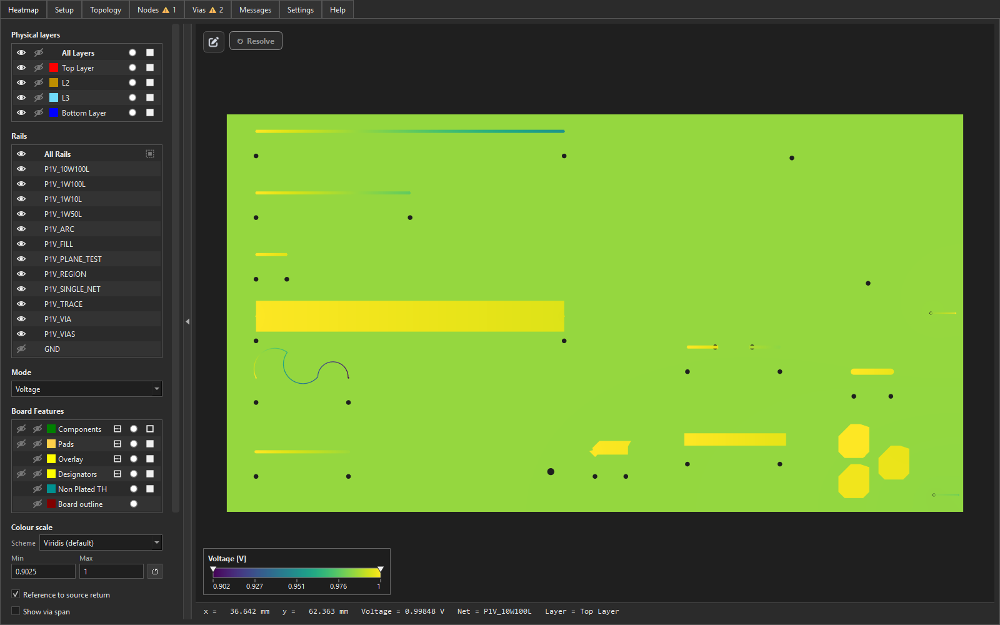

# 5. The viewer tour

Once FYPA has solved your PDN, the viewer is where you spend the rest
of your time. This section walks through the layout, the tabs on the
side panel, the display modes, and the interactions worth knowing.

> The first four sections all assume you have a solved project open in
> the viewer. If you have not got that far yet, start with
> [Section 1.6](01-sources-and-sinks.md#16-importing-into-fypa).

## 5.1 Layout overview

A row of tabs runs across the top — **Heatmap**, Setup, Topology,
Nodes, Vias, Messages, Settings and Help. The **Heatmap** tab, where
you spend most of your time, is itself split into three areas:

- **Control panel (left)** — the Heatmap tab's controls, top to bottom:
  the **Physical layers** list, the **Rails** list, the **Mode**
  dropdown, the **Board Features** toggles, and the **Colour scale**
  (scheme picker and Min / Max boxes).
- **Viewport (centre / right)** — the OpenGL canvas. Shows the current
  layer's copper, shaded by the current display mode. Pan with the
  mouse, zoom with the wheel.
- **Status bar (bottom)** — hover-probe readouts (the x / y / value /
  net / layer under the cursor) and short hints.

A small **colour-scale strip** is pinned to the bottom-left of the
viewport, with two draggable handles for clamping the display range.

The remaining tabs hold the node / via tables, the topology diagram,
solver messages, and settings — each is covered in its own section
below.

## 5.2 The Setup tab

The Setup tab is the control surface for what the viewport shows.
From top to bottom:

- **Layer picker** — every copper layer in the stackup. Click to
  switch which layer the viewport renders.
- **Rail picker** — every rail FYPA inferred from your `PDN_P_NET` /
  `PDN_N_NET` pairs. Click to switch which rail's voltage / current is
  shown.
- **Mode dropdown** — *Voltage*, *Voltage Drop*, *Current Density* or
  *Power Density* (see 5.4).
- **Colour-scheme picker** — the matplotlib colormap used to shade the
  mesh (default `viridis`).
- **Min / Max boxes** — type a value to clamp the colour scale, or
  drag the handles on the scale strip in the viewport.
- **Per-layer transparency buttons** — fade individual layers to see
  underlying copper.

> Use the **R** hotkey to toggle "rail-only" mode — hides everything
> except the selected rail's copper. Useful on a busy board where
> you want to see one rail without the visual noise of all the
> others.

## 5.3 The Topology tab

The **Topology** tab shows the **power tree** of the PDN
simulation model — each `PDN_*` directive appears as a coloured box with
labelled input/output ports; wires connect ports that share the same net.
This is **not** the PCB layout; for spatial placement use the Heatmap tab.

- **Rows** — each SOURCE starts a row, and each REGULATOR gets its own
  row directly under the row that feeds it, indented one step per
  conversion stage, so reading top to bottom follows the power tree. A
  header line names the row and summarises it (`+12V → BUCK · 1 V → +VDD`).
  Within a row power flows left to right: a net's driver on the left, the
  parts it feeds stacked in the next column.
- **Tags** — a rail that leaves the row is not drawn as a long wire. It
  ends in a pentagon **tag** instead: `U6` (magenta) where a rail feeds a
  regulator, the input net (red) on the regulator's own row, the net name
  where a rail loops back to a part drawn elsewhere. **Click a tag** to
  jump to the other end; hovering one highlights the whole net. A dashed
  amber tag marks a rail nothing drives (such rails get their own
  *Undriven rail* row); a grey tag marks a rail with no sink or regulator.
- **Ground** — every part with a return gets its own ground symbol under
  it; there is no shared return rail.
- **Bridges** — 0 Ω auto-bridges on a powered rail show as one-line chips
  on that rail. Auto-bridges on nets no source, sink or regulator uses
  (pull-up links, signal jumpers) are hidden; toggle **Bridges** on the
  toolbar to list them, grouped by net.
- **Classic** — toggles back to the older single-chain column layout,
  which wires every net and draws one return rail under the diagram. Both
  toolbar toggles are remembered between sessions.
- **Nodes** — one box per directive (SOURCE, SINK, REGULATOR, SERIES);
  the header shows the role colour and designator; the body shows the
  configured value (`PDN_V`, `PDN_I`, `PDN_R`, regulator gain).
- **Ports** — small connectors on the left (inputs) and right (outputs).
  Each port is labelled with the **physical PCB net name** from the pad
  assignment (the same names you see on the Heatmap and in the Nodes
  table), not the schematic `PDN_*_NET` text or the merged rail name from
  the Rails list. Ground ports are the exception: they keep the schematic
  name you gave them (`GND`, `AGND`, …). When one directive terminal ties
  several pads on different nets (multi-pin part), the port label lists
  every distinct net, comma-separated; hover the port for the full list if
  the label is truncated. Multi-channel parts show one net per channel row
  (`N1`, `N2`, …) — the net that row's wire actually carries.
- **Wires** — orthogonal links between ports on the same electrical net,
  each labelled once above the link. Single-net directives (ideal return)
  show only their power port and are drawn in a darker shade.
- **Annotation errors** — errored directives get a red border and ⚠ marker.
- **Click a box** — opens that part's PDN properties in a sidebar on the
  right: the same form as the Heatmap's PDN editor panel. A part set up in
  the schematic shows its values read-only with **🔓 Unlock to edit**; a
  part with several FYPA directives (one per rail) gets a picker above the
  form. **Apply** updates the diagram straight away; **↻ Resolve** on the
  toolbar re-solves.
- **⌖ icon** (bottom-right of each box) or **Show on Heatmap** in the
  sidebar — jumps to that component's pad on the Heatmap (same as **Go ▶**
  on the Nodes tab).
- **Hover a box or port** — tooltip with the configured value.

### Adding sources, regulators and sinks from the diagram

Click a **dashed amber tag** (a rail nothing drives) to add a SOURCE on
it or a REGULATOR whose output it is; click a **grey tag** (a rail with
no loads) to add a SINK. A dialog lists every part with a pin on that
net — the part auto setup would pick comes first, marked ★, with its
value, input net and type filled in where the design gives them. Pick
one, check the value (`3.3 V`, `250 mA`, `0.5` — SI prefixes are fine
here) and **Add**; the new directive's sidebar opens so you can refine
its pins or return.

### Manual setup

**Manual setup…** on the toolbar opens the whole supply side of the PDN
as two lists, **Sources & regulators** and **Loads**, each with **Add**,
**Duplicate** and **Remove** and an editor for the selected row:

- **Supplies** have a **Type**: *Source* (an ideal supply such as a
  connector), *LDO* (input current = output current) or *Switcher* (input
  power = output power ÷ efficiency). A regulator also needs its **Input
  net**, and a switcher takes an efficiency and an optional topology.
- **Loads** take a current and an optional minimum voltage; the Nodes tab
  flags the load if its pins sag below that.
- Every row is picked the same way: the **net** (type to search; rails
  come first), then the **part** on it (busiest first, e.g.
  `U7  MAX38913AATD+  (3)`), then optionally its **pins** (blank = all
  of that part's pins on the net). **Ground** is the return net, or
  *(ideal return)* for a source or load that returns through an ideal 0 V
  node.
- Empty fields fill in from the design, and nothing you typed is
  overwritten: the voltage from the net name (`+1V8` → 1.8 V), the
  ground from the part's ground pins, and a regulator's input when the
  part has exactly one other rail.
- **Split across nets…** (Loads) shares one part's total current over
  all its supply rails by how many supply pins each has, e.g. a level
  shifter on both its VCC(A) and VCC(B) rails.
- Directives defined in the Altium schematic are listed locked (🔒).
  **Override** turns one into an editable FYPA copy that replaces it on
  the next resolve; removing the copy brings the schematic one back.
- Problems are listed under the tabs. Errors, such as a missing value,
  pins that aren't on the chosen net, or input = output, must be fixed
  before **Apply**. Warnings, such as a load on a rail nothing supplies
  yet, don't block it.

Nothing changes until **Apply**. Series elements (sense resistors,
ferrites, 0 Ω links) are set up on the **Bridges** tab, and free markers
dropped on the Heatmap are left as they are.

### Auto setup

**Auto setup…** on the toolbar proposes a whole PDN setup and lets you
review it before anything changes:

1. **Datasheet folder** (optional). PDFs are matched to parts by part
   number, from the file name or else the first page, so
   `INA238AQDGSRQ1` finds `ina238.pdf`. From a datasheet it reads whether
   a part is a regulator, LDO or switcher, its topology, efficiency,
   supply / quiescent current and DC resistance or on-resistance. Without
   a folder it works from the design alone, and those values become
   estimates.
2. **Analyse.** The design is read for pin names (`VIN`, `VOUT`, `SW`,
   `VCC(A)`…), net names (`+1V8` means 1.8 V), part parameters and the
   power-port symbols on the schematic:
   - **Regulators**: parts with input and output pins on different rails,
     or a switch pin whose inductor leads to the output. A part with the
     same voltage in and out and no switch pin is a load switch: SERIES.
   - **Sources**: a connector on a rail nothing on the board drives.
   - **Sinks**: ICs with supply pins (VCC, VDD, VS…) on a rail, one per
     part and rail.
   - **Series**: resistors under 1 Ω and ferrite beads between two rails.
   Parts already set up in the schematic or the editor are left alone.
3. **Review.** Each suggestion has a tick box, its nets, an editable value
   (double-click), and for regulators the type and efficiency.
   **Amber** values are estimates. Rows missing a value (a regulator
   whose output rail name carries no voltage, say) can't be ticked until
   you fill it in. Select a row to see why it was suggested, including the
   datasheet sentence a value came from. **Apply** adds the ticked
   suggestions as ordinary FYPA editor directives; edit or remove them
   like any other.

Auto setup only reads the design and proposes values; nothing is solved
until you press **↻ Resolve**. Datasheet values are typical figures pulled
from the text, so treat every suggestion as a starting point to check.

### Navigation and zoom

The diagram is rendered as a **vector schematic** (SVG) and can be
panned and zoomed independently of the Heatmap viewport:

| Action | How |
|--------|-----|
| **Scroll vertically** | Mouse wheel (no modifier). |
| **Scroll horizontally** | **Shift** + mouse wheel. |
| **Zoom** | **Ctrl** + mouse wheel (around the cursor), or the **+** / **−** toolbar buttons. |
| **Fit diagram** | **Fit** toolbar button, or **Ctrl+0** while the Topology tab is focused. A tall power tree fits its width and starts at the top; scroll for the rest. |
| **Pan** | Middle-button drag, or hold **Space** and drag with the left button. |
| **Pan (keyboard)** | Arrow keys; hold **Shift** or **Ctrl** for larger steps. |

Keyboard zoom shortcuts (**Ctrl++**, **Ctrl+=**, **Ctrl+-**) work while
the Topology tab (or one of its controls) has focus.

> **Note:** Heatmap gestures differ — there the mouse wheel zooms the
> board view directly (see [Section 5.10](#510-interaction-reference)).
> On the Topology tab, plain wheel scrolls and **Ctrl**+wheel zooms,
> matching browser and document-viewer conventions.

## 5.4 The display modes

Switching the mode dropdown (or pressing **M** to cycle, **Shift+M**
to cycle back) changes what each mesh vertex's colour represents:

| Mode               | Units    | What it shows                                                                                  |
|--------------------|----------|------------------------------------------------------------------------------------------------|
| **Voltage**        | V        | Absolute potential at every node. The hottest colour is the supply, the coldest is the return. |
| **Voltage Drop**   | V        | Signed drop relative to the rail's source. Useful for "how much voltage have I lost between J1 and U5?" |
| **Current Density**| A / mm²  | Magnitude of the current density `|J|` per mm² of copper cross-section at every node, so layers of different copper weight compare directly. Highlights bottlenecks. Via barrels show their current over the plated wall's cross-section; series resistors are drawn grey. |
| **Power Density**  | W / mm²  | Resistive power dissipation per unit area. Highlights hot spots — where copper will warm up. |
| **Via Current**    | A        | Current through each via; the copper is drawn grey as context. |

> Current Density and Power Density tend to spike sharply at narrow
> tracks and pad corners. The colour scale auto-clips the top end on
> these modes so a single 10× spike does not flatten the rest of the
> board into one colour. Use the Min / Max boxes to override.

## 5.5 The Nodes tab

One row per terminal pin (every pad on every SOURCE / SINK /
REGULATOR / SERIES directive). Columns:

- **Designator / Pad** — which part, which pad.
- **Net** — the net this pin connects to.
- **V** — the solved voltage at this pin.
- **Min V**, **Margin**, **Status** — only populated for SINK pins
  that carry a `PDN_MIN_V` value
  (see [Section 1.3](01-sources-and-sinks.md#optional-pdn_min_v--minimum-acceptable-voltage-at-the-sink)).
  *Margin* is the measured voltage minus the minimum; rows with a
  negative margin are highlighted red with `Status = FAIL`.

The table is sortable — click a column header to sort by it. Sorting
by Margin ascending is the fastest way to find which pin is closest
to falling below its limit.

Right-click a SINK row and choose *Show fixes for …* to open the
**Fixes** tab on that load.

### The Fixes tab — where would copper help?

The heatmap shows where current flows. The **Fixes** tab answers the
question you ask next: *for this load, where would extra copper cut its
drop the most?* Copper carrying another load's current, or copper beyond
the load, scores nothing.

- **Loads** (left) — every SINK, worst first, by how much of its drop
  budget it uses. The budget is `nominal − PDN_MIN_V` when the sink has
  a `PDN_MIN_V`, otherwise 5 % of the rail's nominal voltage. Over-budget
  loads are red. The drop is the same number the design report shows.
- **Fixes** (right) — for the selected load, ranked by the voltage each
  would gain:
  - **Widen** — push this copper edge out by 0.25 mm. For a trace,
    either edge.
  - **Add layer** — a stitched parallel copy of the copper, same weight,
    on another layer. The layers with room for it are named.
  - **Add via** — another via beside this one.

  Fixes that would run into another net's copper are greyed and listed
  last. Click **Go** to jump to a fix on the heatmap.

**Show fixes on the heatmap** draws every fix of the selected load over
whatever mode the heatmap is in — a line along an edge to widen, a dashed
outline round copper to parallel, a ring on a via — numbered as in the
table. **Show value map** colours the heatmap by where parallel copper
would help the load most (volts gained per mm²) instead of the Mode
quantity; choosing a mode turns it off.

The ranking comes from one extra ("adjoint") solve per load, done with
the main solve, so it adds little to solve time. The estimates are
**first order**: they hold well for modest changes (a widen estimate on
a test trace was within 1 % of re-solving with the trace widened; a
parallel-layer estimate within 10 %) and are optimistic for large ones.
Re-solve to confirm a fix.

## 5.6 The Vias tab

One row per via on the board, with the current flowing through it.
Columns:

- **Net** — which net the via belongs to.
- **From / To** — the two layers it connects.
- **Current (A)** — the solved current through the via.

Sort by Current descending to spot vias that are carrying too much —
a 0.3 mm hole carrying 2 A is a future failure. The
[via resistance model](../via_resistance_model.md) covers how those
currents are computed.

## 5.7 The Messages tab

Warnings and diagnostics from the loader and solver — anything that
did not abort the run but is worth knowing about. Examples:

- Net names referenced in `PDN_*` parameters that were not found on
  the PCB (and were therefore skipped).
- Editor directives that could not be applied (skipped, not aborted —
  see [Section 2.9](02-sources-and-sinks-editor.md#29-troubleshooting)).
- Solver warnings about near-singular matrices, suspicious gradients,
  etc.

Worth a glance after every solve. If everything is healthy, the tab
shows a short "no issues" message.

## 5.8 The Settings and Help tabs

- **Settings** — viewer-wide preferences (default colormap, marker
  visibility, hover-probe behaviour, theme).
- **Help** — built-in cheatsheet of hotkeys and gestures.

## 5.9 The Heatmap tab

The viewport itself lives in a tab called *Heatmap*. You will rarely
click away from it during normal use — the other tabs hold the setup
controls, node / via tables, messages, and settings.

## 5.10 Interaction reference

| Action                          | How                                                                  |
|---------------------------------|----------------------------------------------------------------------|
| Pan                             | Left-click and drag in the viewport.                                 |
| Zoom                            | Mouse wheel.                                                         |
| Hover-probe a value             | Move the mouse over copper — the value (in the current mode's units) appears in the status bar, along with the net and layer. |
| Clamp the colour scale          | Drag the two handles on the colour strip, or type values into the **Min** / **Max** boxes on the Setup tab. |
| Click a piece of copper         | Selects it — the bottom bar reports the net, the area, and (where applicable) the layer-local current. |
| Click a marker                  | Reports the directive value (source voltage, sink current, etc.) in the bottom bar. |
| Left-drag on empty board (editor mode, 2D) | Rubber-band selects every PDN marker fully inside the box, for editing several sinks at once (see [Section 2.6](02-sources-and-sinks-editor.md#26-editing-several-sinks-at-once)). |
| Resolve after editor edits      | Click the green **↻ Resolve** button at the top-left of the viewport (see [Section 2.7](02-sources-and-sinks-editor.md#27-re-solving-and-saving)). |

## 5.11 Hotkeys worth remembering

| Key          | Action                                                                |
|--------------|-----------------------------------------------------------------------|
| **M / Shift+M** | Cycle the display mode forward / backward.                         |
| **H / Shift+H** | Cycle the colour scheme forward / backward.                        |
| **R**        | Toggle rail-only mode (hide other rails' copper).                     |
| **O**        | Toggle copper outlines.                                               |
| **I**        | Toggle SOURCE / SINK / SERIES / via markers.                          |
| **A**        | Toggle current-flow arrows on the heatmap.                            |
| **V**        | Toggle via overlay on the heatmap.                                    |
| **T**        | Toggle the hover-probe tooltip.                                       |
| **2 / 3**    | Switch the viewport to 2-D / 3-D mode.                                |
| **0**        | Reset the 3-D camera.                                                 |
| **E**        | Toggle editor mode (see [Section 2.2](02-sources-and-sinks-editor.md#22-entering-editor-mode)). |
| **S** / **L** | In editor mode, arm a free **S**OURCE / sink (**L**oad) drop — the keyboard equivalent of the red / blue triangle buttons. |
| **Ctrl+S**   | Save the project (the dialog offers project-only or project+solution). |

The Help tab inside the viewer has the authoritative, always-current
list — if a hotkey here looks wrong, that tab is the source of truth.

## Next steps

- For exporting your solve to a tool that does 3-D stackup
  visualisation, slicing, and publication-quality plots, see
  [Section 6 — Exporting to ParaView](06-paraview-export.md).
